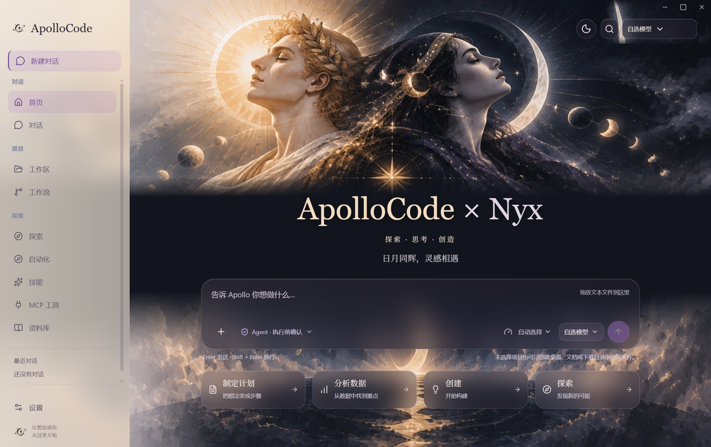

# Apollo Code

当前版本 **0.8.2**：独立 Hermes 后端、多对话并行、多文件附件和流式输出。安装包随附 Python 与依赖，保留配置和聊天记录。详见 [更新说明](RELEASE-0.8.2.md) 和 [发布页](https://github.com/Acromare/ApolloCode/releases/tag/v0.8.2)。

**接入你自己的模型，把想法变成能执行的任务。**

Apollo Code 是面向编码与自动化的桌面 Agent 工作台。你选择模型服务、配置接口和凭证；Apollo 提供内置 Skills、项目工具和上下文管理，让模型围绕真实文件完成工作，也让 Token 消耗更容易控制。

应用不内置模型权重，也不提供共享模型账户。云端服务由你接入；本地模型可以通过你另行部署的 Ollama 服务连接。

[下载 Windows 版](https://github.com/Acromare/ApolloCode/releases/latest) · [快速开始](#快速开始) · [内置-skills](#内置-skills) · [token-优化](#token-优化) · [English](README.en.md)



*界面示意，模型由你自行配置。*

## 你的模型，你的工作台

从一个问题开始，也可以直接给出任务：解释项目、定位错误、修改代码、执行测试，或者把重复操作整理成工作流。对话、项目与设置分区展示；工作过程默认简洁收起，需要时再展开查看工具操作与结果。

Apollo 将模型连接到工作现场：Skills 提供可复用的方法，工具负责读取和执行，上下文管理减少重复与无关信息。任务的理解和生成由你接入的模型完成。

| 你想做的事 | Apollo 提供的支持 |
|---|---|
| 熟悉项目 | 文件浏览、定向读取、代码搜索、TS/JS 诊断与定义查询 |
| 修复问题 | 小范围补丁、审批执行、Shell、项目测试与 Git 差异 |
| 审查与交付 | 代码审查 Skills、指定文件提交、推送与 GitHub 草稿 PR |
| 完成长任务 | 持久任务进度、历史片段检索、暂停继续与追加指令 |
| 分开处理子任务 | 并行只读调查、审批后在独立 Git worktree 中修改 |
| 复用成熟方法 | 内置与自定义 Skills、审批学习、修订记录与恢复 |
| 处理重复工作 | 可编辑工作流、单次/间隔/cron 定时任务与结果记录 |
| 连接更多工具 | MCP、本机及外部终端、授权浏览器与 Windows 操作 |

## 快速开始

### 1. 下载并启动

在 [Releases](https://github.com/Acromare/ApolloCode/releases/latest) 选择适合你的包：

| 文件 | 使用方式 |
|---|---|
| `Apollo-Code-Setup-0.7.2-x64.exe` | Windows x64 安装版，可以选择安装目录并创建快捷方式 |
| `Apollo-Code-Portable-0.7.2-x64.exe` | Windows x64 便携启动版，无需安装；首次启动会解压运行文件 |
| `Apollo-Code-source-0.7.2.zip` | 源码归档，适合查看实现或自行构建 |

便携版也会保存本机配置与对话，并非所有数据都跟随单个 EXE 移动。当前安装包尚未数字签名。

### 2. 接入模型

打开 **设置 → 模型与供应商**，填写接口地址、API 密钥并选择模型，随后测试连接。

- **OpenAI 兼容服务**：支持 Responses 与 Chat Completions，可以自动选择或指定协议。
- **Anthropic**：使用对应服务的接口与凭证。
- **Ollama**：连接你已部署的本地模型服务。
- **Claude Code CLI**：使用已安装 CLI 的登录状态和运行时。

模型列表可以搜索和切换。兼容 Responses 的服务可以设置推理强度；可用选项与工具、视觉能力取决于实际服务支持。协议不兼容时，按服务商的接口说明调整配置。

### 3. 选择项目，开始工作

打开项目文件夹，先试一个容易核查的任务：

> 解释这个项目的入口和主要模块，先不要修改文件。

再逐步交给模型可执行的工作：

> 找到这个测试失败的原因，说明修改方案，批准后修复并运行相关测试。

| 模式 | 适合的工作 |
|---|---|
| Chat | 直接对话，不提供原生执行工具 |
| Plan | 读取与分析项目，形成方案 |
| Agent | 使用工具执行任务，按权限要求确认操作 |
| YOLO | 减少常规操作确认；部分敏感操作仍需审批 |

输入框支持多行文本、文本文件拖放与粘贴。`Enter` 发送，`Shift + Enter` 换行；中文输入法确认候选词不会误发送消息。

### 4. 在执行中调整方向

任务执行时，可以展开工作过程核查操作，也可以追加要求。追加内容会在后续模型轮次生效。

点击暂停后，Apollo 在当前模型请求或工具操作结束的边界暂停；已暂停时可以继续追加指令，点击继续才会恢复。停止会结束当前任务。已完成的外部操作不会因暂停或停止而撤销。Claude Code CLI 使用独立运行时，目前只提供停止入口。

## 内置 Skills

Apollo 提供 11 个内置技能，支持导入自己的 `SKILL.md`。在技能页选择启用项，Agent 与 Plan 模式会获得精简目录，在需要时加载相关内容；主动选择某个技能时，其指令会随请求发送。

| Skill | 用途 |
|---|---|
| `plan-planner` | 整理目标、涉及文件、步骤与验证方案 |
| `context-routing` | 逐步定位相关代码，减少无关读取 |
| `patch-editor` | 根据已读内容生成小范围补丁 |
| `code-review` | 检查具体缺陷与回归，给出位置和依据 |
| `test-runner` | 围绕相关测试和失败日志定位问题 |
| `git-workflow` | 检查 Git 状态、差异与交付步骤 |
| `data-analysis` | 分析数据，区分事实与不确定性 |
| `sandbox-gate` | 检查项目路径、敏感信息与文件操作范围 |
| `token-saver` | 复用已知信息、读取必要片段、减少重复上下文 |
| `context-compression` | 整理长任务摘要，保留决策、文件和未完成事项 |
| `context-optimization` | 指导上下文预算、信息筛选与检索范围 |

完成经过验证的流程后，可以要求 Agent 将它总结为技能。保存前需要批准；保存后可以编辑、启用、查看修订记录，并审批恢复旧版。技能提供工作方法，执行效果取决于模型与工具支持。

第三方技能来源与许可证见 [THIRD-PARTY-NOTICES.md](THIRD-PARTY-NOTICES.md)。

## Token 优化

减少每轮发送的冗余信息，是 Apollo 的核心能力之一。可以在设置中调整预算与限额，在用量页面检查实际记录。

- **技能按需加载**：保留精简目录，在相关任务中加载正文，避免反复发送所有技能。
- **工具输出精简**：过滤重复行和进度信息，截取诊断片段，为单次工具输出设置上限。
- **长对话管理**：按预算保留最近上下文，可以生成早期历史摘要；摘要会复用已有缓存。
- **项目历史检索**：开启后，仅在工具请求时提供匹配片段，不同项目分开检索。
- **可见的用量**：展示服务返回的输入、输出与缓存 Token，以及工具输出减少量的估算；按你填写的价格估算费用。

摘要、记忆提取与并行子任务也会产生模型调用。可以按任务选择开启，节省幅度根据实际用量衡量。用量估算与服务商账单可能存在差异。

## 从一次对话，到可复用的工作

**任务与记忆。** 项目页保留任务计划、下一步和最近操作。重启后未完成任务标记中断，返回聊天后先核查状态再继续。历史检索默认关闭，可在记忆设置中开启或清除索引；长期记忆保存需要批准。

**并行子任务。** 可以同时进行最多三个只读调查。需要独立修改时，审批后创建 Git worktree，在项目页查看状态、目录和与基线的差异。修改保留供审查，不会自动合并到主工作区。

**工作流与定时任务。** 将模型、Shell 或测试步骤组合成有依赖关系的工作流。自动化页支持单次、固定间隔和 cron；任务默认停用，启用或立即运行前需要确认。计划只在应用运行时执行，不补跑关闭期间错过的任务。

**工具扩展。** 配置 MCP 进程或 HTTP 服务，选择可用工具。终端支持本机与 Docker、SSH、Singularity 适配，外部后端需要配置对应环境。授权后可提供浏览器或 Windows 窗口截图，并执行点击、输入、滚动与拖拽。

## 界面与更新

光明神、黑夜神与日月同辉三个主题，搭配半透明输入框、轻量控件和可折叠工作过程。界面支持简体中文与 English，语言与主题偏好会保存。

有新的稳定版本时，Apollo 会显示版本说明弹窗。点击下载更新会打开 GitHub Release 页面，由你下载并安装；软件不会自动升级。启动后检查更新，也可以在 **设置 → 更新** 中手动检查。任务执行期间会延后自动弹窗，稍后提醒会暂缓该版本的通知。

## 用得更顺手

把目标、范围和验证方式一起告诉 Agent，通常比反复补充要求更高效。例如：

> 修复登录页提交后一直加载的问题。先查相关代码，只修改必要文件，保留现有样式；完成后运行相关测试，并说明我应该怎样手动验收。

> 审查这次 Git 差异，重点看错误处理和数据丢失风险。给出具体位置、触发条件与修复建议，先不要修改。

> 把刚才已经验证通过的排错步骤整理成 Skill，保留适用条件和验证方法，先让我审查再保存。

新项目可以先用 Plan 熟悉结构，再切到 Agent 实施。长任务使用项目中的进度记录接续；需要找回之前的决定时，开启项目历史检索。外部终端、MCP 和定时任务按需要配置，先用小任务确认环境可用。

## 常见问题

**已经选择模型，为什么不能操作文件？** 先检查是否选择了项目目录和 Agent 模式；Chat 模式只对话。模型服务还需要支持对应协议的工具调用，执行操作可能等待你审批。

**连接成功，实际任务仍失败？** 简单连通性检查不能覆盖流式响应、工具调用和图片请求。检查接口协议、模型能力与供应商限制；上游拒绝访问或 HTTP/2 流错误需要结合服务端日志排查，切换模型名称不能保证解决。

**为什么摘要后还有 Token 消耗？** 摘要本身需要一次模型请求，之后能减少历史重传。短对话可以不启用摘要；长任务结合输出限额和按需读取，再根据用量页面评估效果。

**没有看到更新提醒？** 保持联网，在设置中手动检查更新。自动提醒可能因任务正在执行或选择了稍后提醒而延后；网络无法访问 GitHub 时，可以直接打开 [下载页](https://github.com/Acromare/ApolloCode/releases/latest)。

反馈问题时，请提供应用版本、Windows 版本、接口协议、可复现步骤和去掉敏感信息的错误内容。不要提交 API 密钥、私人文件或完整凭证配置。

## 0.7.2 更新

- 重整首页、对话和设置布局，修复选中状态粘连、浮层残留与设置入口位置。
- 加入日月同辉主题，细化玻璃质感、模型选择、推理强度与暂停控件。
- 支持原生任务暂停/继续、执行中追加指令和 Windows CRLF 补丁保留。
- 增加 SQLite FTS5 项目历史检索、持久任务进度与技能版本恢复。
- 增加审批可写 Git worktree 子任务、定时任务和外部终端配置。
- 明确用户自接模型、内置 Skills 与 Token 优化的产品定位。

## 当前范围

主要发布目标为 Windows x64。TS/JS 提供原生语言工具；模型协议和外部软件支持取决于实际环境。

本机 Shell、项目脚本和 MCP 运行在当前用户权限下，worktree 只隔离工作目录，并非操作系统沙箱。外部 Docker/SSH/Singularity 适配已覆盖配置与调用参数检查，尚未逐一连接真实环境验收。消息与语音网关、向量记忆、更多云执行适配仍在后续范围。

本版通过 64 项自动测试、构建与 Electron 界面回归；打包自检覆盖依赖、Skills、FTS5、LSP、Shell 与凭证重读。真实模型任务没有覆盖所有服务，自动测试不能代替你的供应商与环境验收。详见 [验收说明](ACCEPTANCE-2026-10-13.md) 与 [功能状态](STATUS.md)。

## 开发与参与

```powershell
npm install
npm test
npm run build
npm run dev
```

构建 Windows 安装版与便携版：

```powershell
npm run make
npm run make:portable
```

[发布与更新](RELEASING.md) · [签名配置](SIGNING.md) · [Hermes 能力核查](HERMES-PARITY.md) · [提交问题](https://github.com/Acromare/ApolloCode/issues)

欢迎提供可复现的任务、模型协议兼容反馈与经过验证的 Skills。项目采用 [MIT License](LICENSE)。
